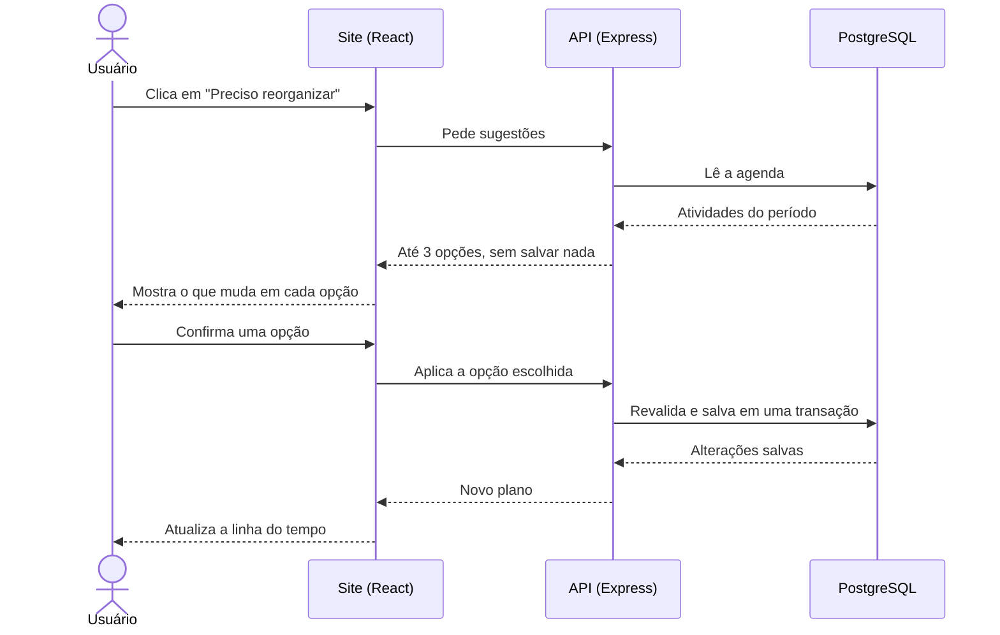
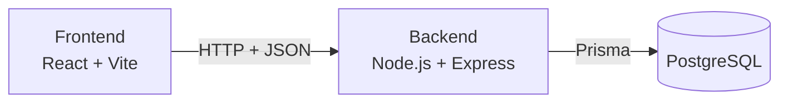

# Plannio

**Planeje seus estudos e sua rotina. Quando o dia mudar, refaça o plano em poucos cliques.**

O Plannio é uma aplicação web para organizar estudos, trabalho e compromissos pessoais em um só lugar. Quando uma atividade atrasa, ele sugere novos horários e mostra tudo o que mudaria, mas a decisão continua sendo de quem usa.

> **Status do projeto:** em fase de especificação. O desenvolvimento segue o [roteiro](#roteiro), e as instruções de instalação serão adicionadas junto com o código.

## Sumário

- [O problema](#o-problema)
- [A solução](#a-solução)
- [Escopo da primeira versão](#escopo-da-primeira-versão)
- [Histórias de usuário](#histórias-de-usuário)
- [Funcionalidades](#funcionalidades)
- [Qualidade e segurança](#qualidade-e-segurança)
- [Regras de negócio](#regras-de-negócio)
- [Fluxo principal: reorganizar o dia](#fluxo-principal-reorganizar-o-dia)
- [Tratamento de erros](#tratamento-de-erros)
- [Arquitetura e tecnologias](#arquitetura-e-tecnologias)
- [Critérios de aceite](#critérios-de-aceite)
- [Definição de pronto](#definição-de-pronto)
- [Roteiro](#roteiro)

## O problema

Quem estuda costuma montar um cronograma e perdê-lo no primeiro imprevisto. Uma aula que termina tarde, um turno de trabalho mais longo ou uma tarefa que demora além do previsto afetam tudo o que vem depois. Refazer o plano à mão dá trabalho, e muitas pessoas simplesmente desistem dele.

A dificuldade é maior para quem concilia estudos com trabalho, atividade física e compromissos pessoais. As agendas comuns guardam horários, mas não ajudam a encontrar um novo lugar para o que ficou para trás nem mostram a diferença entre o que foi planejado e o que realmente aconteceu.

## A solução

O diferencial do Plannio é a **reorganização assistida**. Quando uma atividade atrasa ou não pode ser feita, a pessoa pede ajuda e recebe até três alternativas de horário, com a indicação de tudo o que mudaria em cada uma.

| Princípio | Na prática |
|---|---|
| **Quem usa decide** | Nada muda sem confirmação, e compromissos fixos nunca são alterados por uma sugestão |
| **Tudo em um só lugar** | Estudos, trabalho, saúde e vida pessoal na mesma agenda, com organização por matéria |
| **Plano e realidade lado a lado** | Comparação entre o tempo planejado e o realizado |
| **Imprevisto não é falha** | Textos e números ajudam a entender o tempo, sem tom de cobrança |

**Para quem é:** estudantes de ensino médio e faculdade, pessoas que se preparam para concursos e vestibulares, alunos de cursos livres, profissionalizantes e de idiomas, além de quem concilia estudos com trabalho e compromissos pessoais.

## Escopo da primeira versão

| Incluído | Fora desta versão |
|---|---|
| Cadastro, login, logout e exclusão da conta | Recuperação de senha por e-mail |
| Criação, edição e exclusão de atividades | Login com Google ou redes sociais |
| Categorias e matérias personalizáveis | Aplicativo nativo para Android ou iOS |
| Inbox para atividades sem horário | Arrastar e soltar atividades na linha do tempo |
| Linha do tempo diária e calendário semanal | Detecção automática de atrasos |
| Rotinas recorrentes e ajustes em uma ocorrência | Notificações por e-mail, push ou WhatsApp |
| Compromissos fixos e atividades flexíveis | Integração com Google Agenda ou outros calendários |
| Reorganização com até três sugestões e confirmação | Compartilhamento e recursos entre usuários |
| Registro do status e do horário real, quando informado | Inteligência artificial (as sugestões usam regras definidas) |
| Painel de progresso e histórico | Cronômetro, Pomodoro e medição automática de tempo |
| Tema claro e escuro; uso em computador e celular | Assinaturas e pagamentos |
| Site publicado em link público com HTTPS | Uso offline |

## Histórias de usuário

- Como **estudante**, quero criar atividades com data, horário, categoria e matéria, para que eu veja em um só lugar o que preciso fazer e quando.
- Como **estudante com aulas e horários regulares**, quero criar rotinas que se repetem, para que eu não precise cadastrar a mesma atividade toda semana.
- Como **pessoa que tem imprevistos**, quero alterar ou pular apenas uma ocorrência de uma rotina, para que uma mudança pontual não afete o restante da programação.
- Como **estudante que se atrasou**, quero receber até três sugestões de novo horário, para que eu reorganize o dia sem precisar refazer o plano inteiro à mão.
- Como **pessoa que concilia estudos e trabalho**, quero marcar compromissos como fixos, para que nenhuma reorganização mexa neles.
- Como **usuário**, quero ver o que vai mudar antes de confirmar uma sugestão, para que nenhuma atividade seja alterada sem a minha decisão.
- Como **estudante**, quero guardar atividades sem horário definido na Inbox, para que eu não esqueça delas enquanto decido quando fazê-las.
- Como **estudante**, quero comparar o tempo planejado com o realizado em cada matéria, para que eu entenda como estou usando meu tempo e ajuste os próximos planos.

## Funcionalidades

O site é organizado em seis áreas: **Hoje**, **Semana**, **Rotinas**, **Inbox**, **Progresso** e **Configurações**.

### Conta

- Cadastro com nome, e-mail e senha, além de login e logout.
- Exclusão da própria conta e de todos os dados, após confirmação.
- Alternância entre tema claro e escuro, com a escolha salva.

### Atividades e agenda

- Criar, editar e excluir atividades com nome, categoria, matéria, data, início, término, descrição, prioridade e tipo (fixo ou flexível). Só o nome é obrigatório.
- Criar categorias com cor e matérias próprias.
- Guardar na Inbox as atividades sem data e horário, e agendá-las depois.
- Ver as atividades do dia em linha do tempo e as da semana em um calendário de sete dias.
- Receber um aviso antes de salvar quando houver sobreposição de horários, podendo decidir se mantém.

### Rotinas

- Repetição diária, em dias úteis, em dias específicos da semana ou personalizada (a cada N dias ou semanas), com data de início e data final opcional.
- Escolha entre alterar somente uma ocorrência ou esta e as próximas, preservando as anteriores.
- Pular ou alterar uma ocorrência sem afetar as demais, e cancelar a rotina a partir de uma data.

### Reorganização

- Até três sugestões de novo horário para uma atividade flexível, mantendo a duração, sem conflitos e sem alterar compromissos fixos.
- As sugestões podem mover outras atividades flexíveis, sempre mostrando todas as alterações antes da confirmação.
- Sem horário disponível, é possível escolher outro dia ou enviar a atividade para a Inbox, sem perdê-la.

### Execução e progresso

- Marcar uma atividade como concluída, parcialmente realizada, não realizada ou adiada, e registrar opcionalmente o horário real.
- Painel semanal com a quantidade de atividades por status, o tempo planejado e realizado por categoria e matéria, e a comparação com a semana anterior.
- Histórico com o plano original das atividades alteradas, mantido até que o usuário exclua os registros.

## Qualidade e segurança

| Área | Compromisso |
|---|---|
| **Segurança** | Senhas armazenadas apenas como hash (bcrypt) e sessão em cookie `HttpOnly` |
| **Privacidade** | Cada pessoa acessa somente os próprios dados, com verificação do dono de cada registro no backend |
| **Persistência** | Dados em banco de dados, disponíveis após fechar o navegador ou trocar de dispositivo |
| **Integridade** | Aplicar uma sugestão salva todas as alterações em uma transação: ou tudo é salvo, ou nada muda |
| **Desempenho** | Em condições normais de uso, telas e sugestões aparecem em até 2 segundos |
| **Responsividade** | Sem rolagem horizontal da página a partir de 360 px de largura; no celular, a barra lateral vira menu |
| **Compatibilidade** | Versões atuais de Chrome, Edge, Firefox e Safari |
| **Acessibilidade** | Ações principais pelo teclado, contraste legível nos dois temas e interface em português do Brasil |
| **Validação** | Toda entrada é validada no frontend e novamente no backend |

## Regras de negócio

- **Status inicial:** toda atividade agendada começa como pendente. Se o horário passar sem marcação, ela aparece como “Sem registro” em Progresso, nunca como falha.
- **Atividade adiada:** é marcada pelo usuário quando quer fazê-la depois. Ao receber um novo horário, volta a pendente, e o plano anterior vai para o histórico.
- **O que pode ser reorganizado:** atividades flexíveis pendentes ou adiadas, de qualquer data. Compromissos fixos só mudam por edição manual, e itens da Inbox são agendados manualmente.
- **O que ocupa a agenda:** atividades pendentes, concluídas e parcialmente realizadas. As não realizadas e as adiadas não ocupam horário.
- **Como as opções são escolhidas:** a busca tem três etapas e traz a opção mais cedo de cada uma. Se uma etapa não tiver opção, as outras podem completar até três.
- **Limite de mudanças:** uma sugestão move até duas outras atividades, somente pendentes, flexíveis e sem prioridade alta. Elas só vão para mais tarde no mesmo dia e mantêm a ordem.
- **Contagem em Progresso:** cada atividade conta na data atual do seu plano. Ocorrências puladas e itens da Inbox não contam, e o tempo realizado considera só as atividades com horário real informado.
- **Rotinas:** “esta e as próximas” mantém as ocorrências já alteradas individualmente. Cancelar uma rotina remove as ocorrências pendentes a partir da data e preserva as que têm status registrado.
- **Histórico e exclusões:** o histórico registra reorganizações e mudanças manuais de data ou horário. Excluir uma atividade remove também seus registros e sua contagem. Excluir uma categoria ou matéria mantém as atividades, sem esse vínculo.

## Fluxo principal: reorganizar o dia

**Exemplo:** são 14:20 de uma quarta-feira. *Estudar Matemática* estava planejada para 14:00–15:30, mas ainda não começou. Depois dela vêm *Inglês* (15:30–16:30, flexível) e *Academia* (17:00–18:30, fixa).

1. **Entrada do usuário:** na tela Hoje, a pessoa abre a atividade e clica em **Preciso reorganizar**.
2. **Processamento:** o backend confere a sessão e se a atividade pertence ao usuário, depois procura alternativas com a mesma duração, sem sobreposição e sem alterar compromissos fixos. Os horários começam a cada 30 minutos, dentro do período de planejamento (06:00–23:00 por padrão), e a busca segue três etapas:
   - um horário livre no dia, sem mover nada;
   - um horário no dia, movendo atividades flexíveis;
   - os próximos sete dias, tentando primeiro o mesmo horário original.
3. **Retorno na tela:** o sistema mostra as opções e o que mudaria em cada uma. Nada é salvo até a confirmação.

| Opção | Novo horário de Matemática | Outras mudanças |
|---|---|---|
| 1 | Hoje, 18:30–20:00 | Nenhuma |
| 2 | Hoje, 14:30–16:00 | Inglês passa para 16:00–17:00 |
| 3 | Amanhã, 14:00–15:30 | Nenhuma |

Ao confirmar, o backend salva tudo em uma transação, registra a alteração no histórico, e a tela Hoje exibe o novo plano. Se a pessoa cancelar, nada muda.



## Tratamento de erros

| Situação | Como o sistema responde |
|---|---|
| Não há horário disponível nos dias pesquisados | Explica a situação e oferece escolher outro dia ou enviar a atividade para a Inbox. Ela nunca é perdida. |
| A agenda mudou entre a sugestão e a confirmação | Não salva nada, avisa o usuário e calcula novas opções com a agenda atual. |
| A conexão cai durante a confirmação | Mantém a tela aberta, avisa do erro e oferece **Tentar novamente**, sem duplicar alterações. |
| A sessão expirou | Pede novo login e não altera nenhuma atividade. |
| A atividade não existe mais ou pertence a outro usuário | Informa que não foi encontrada, sem revelar dados, e atualiza a lista. |
| Entrada inválida (nome vazio ou término antes do início) | Não salva, mantém o que foi digitado e mostra a mensagem junto ao campo incorreto. |

## Arquitetura e tecnologias



| Camada | Tecnologia | Responsabilidade |
|---|---|---|
| **Frontend** | React, Vite, JavaScript, React Router e CSS | Telas, navegação, formulários, temas e responsividade |
| **Backend** | Node.js, Express e JavaScript (API REST) | Autenticação, validação, recorrência, reorganização e progresso |
| **Armazenamento** | PostgreSQL com Prisma | Usuários, atividades, rotinas, exceções e histórico |
| **Publicação** | Hospedagem com HTTPS | Site, API e banco acessíveis por um link público |

**Por que esta combinação:** React e Node.js permitem usar JavaScript em todo o projeto, o que facilita aprender, manter e explicar o código. O backend próprio protege as contas e concentra as regras mais importantes. O PostgreSQL é adequado porque os dados são relacionados entre si, e as transações garantem que uma reorganização nunca fique salva pela metade.

### Organização do código

```text
plannio/
├─ client/                  # Frontend (React)
│  └─ src/
│     ├─ pages/             # Hoje, Semana, Rotinas, Inbox, Progresso, Configurações, Login
│     ├─ components/        # Linha do tempo, blocos, formulários, janelas
│     ├─ services/          # Chamadas à API
│     └─ context/           # Usuário logado e tema
└─ server/                  # Backend (Node.js + Express)
   ├─ prisma/               # Estrutura do banco de dados
   └─ src/
      ├─ routes/            # Endereços da API
      ├─ middlewares/       # Verificação de login e validação
      ├─ controllers/       # Recebem a requisição e devolvem a resposta
      └─ services/          # Regras: recorrência, reorganização e progresso
```

### Principais dados

| Entidade | O que guarda |
|---|---|
| **Usuário** | Nome, e-mail, hash da senha, período de planejamento e tema |
| **Categoria** | Nome e cor (exemplos iniciais editáveis: Estudos, Trabalho, Saúde e Pessoal) |
| **Matéria** | Nome de uma disciplina, curso ou área de estudo |
| **Atividade** | Dados planejados, tipo, status, horário real opcional e vínculo com a rotina |
| **Rotina** | Modelo da atividade e regra de repetição |
| **Exceção da rotina** | Ocorrência pulada ou alterada, sem mudar o modelo da rotina |
| **Registro de alteração** | Plano anterior e novo plano de cada reorganização ou mudança de horário |

## Critérios de aceite

- Ao se cadastrar e entrar, a pessoa acessa a tela Hoje; com senha incorreta, o acesso é negado com mensagem clara.
- Dois usuários não conseguem ver nem alterar dados um do outro, mesmo chamando a API diretamente.
- Uma atividade sem nome ou com término antes do início não é salva, e o erro aparece junto ao campo.
- Uma atividade sem horário aparece na Inbox e, depois de agendada, aparece em Hoje e Semana.
- Uma rotina de segunda, quarta e sexta gera as ocorrências corretas, e alterar só a de quarta não muda as outras.
- Ao escolher “esta e as próximas”, as ocorrências passadas continuam iguais, e uma ocorrência futura já alterada não perde a alteração.
- No exemplo do fluxo principal, com o dia seguinte livre às 14:00, o sistema apresenta exatamente as três opções da tabela, sem mover a Academia e sem sobreposição.
- Antes de confirmar, nada muda no banco; ao confirmar, todas as alterações são salvas juntas.
- Quando não há horário disponível, é possível escolher outro dia ou a Inbox, e a atividade continua existindo.
- Ao marcar status e horário real, os totais de Progresso seguem as regras definidas, e atividades passadas sem marcação aparecem como “Sem registro”.
- Depois de fechar o navegador e entrar novamente, os dados continuam salvos, e o plano original de uma atividade reorganizada aparece no histórico.
- A conta pode ser excluída após confirmação e não permite novo acesso.
- As seis áreas funcionam em 360 px e em computador, nos dois temas, sem rolagem horizontal da página.
- No link público com HTTPS, a mesma conta mostra os mesmos dados no computador e no celular.

## Definição de pronto

O Plannio será considerado finalizado quando:

- todos os critérios de aceite forem cumpridos sem travamentos;
- os cenários de erro mostrarem mensagens claras, sem perda de dados;
- as regras de recorrência e reorganização tiverem testes automatizados passando;
- o site estiver publicado com HTTPS e testado em Chrome, Edge, Firefox e Safari, em computador e celular;
- o repositório tiver instruções para instalar, configurar o banco, executar e publicar o projeto;
- nenhuma senha ou chave secreta estiver salva no repositório.

## Roteiro

- [x] Especificação do produto
- [ ] Redesign da interface
- [ ] Base do projeto, banco de dados e contas
- [ ] Agenda, atividades e rotinas
- [ ] Reorganização assistida
- [ ] Progresso e histórico
- [ ] Telas e responsividade
- [ ] Testes do fluxo completo
- [ ] Publicação
