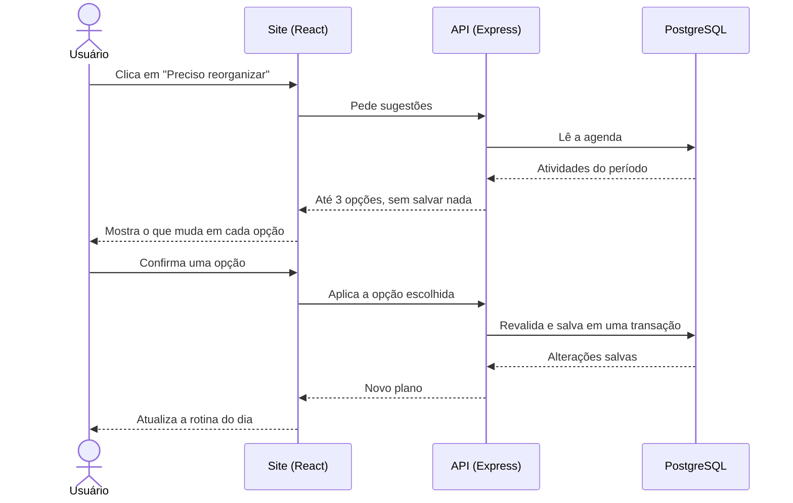
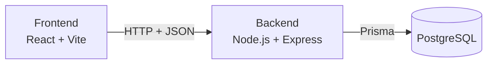

# Plannio

**Sua rotina, hora por hora.**

O Plannio é uma aplicação web para organizar o dia a dia. Você coloca o que vai fazer em cada horário, como acordar, ir para a faculdade e estudar. O site mostra o que fazer naquela hora, você marca o que fez e acompanha sua semana com uma ofensiva.

> **Status do projeto:** em fase de especificação. O desenvolvimento segue o [roteiro](#roteiro), e as instruções de instalação serão adicionadas junto com o código.

## Sumário

- [O problema](#o-problema)
- [A solução](#a-solução)
- [Escopo da primeira versão](#escopo-da-primeira-versão)
- [Histórias de usuário](#histórias-de-usuário)
- [Funcionalidades](#funcionalidades)
- [Qualidade e segurança](#qualidade-e-segurança)
- [Regras de negócio](#regras-de-negócio)
- [Fluxo principal: reorganizar o dia](#fluxo-principal-reorganizar-o-dia)
- [Tratamento de erros](#tratamento-de-erros)
- [Arquitetura e tecnologias](#arquitetura-e-tecnologias)
- [Critérios de aceite](#critérios-de-aceite)
- [Definição de pronto](#definição-de-pronto)
- [Roteiro](#roteiro)

## O problema

Quem tem aulas, trabalho, estudos e compromissos pessoais costuma guardar a rotina na cabeça ou em anotações soltas. Isso dificulta saber o que fazer em cada momento e perceber se a semana realmente está indo como planejado.

As agendas comuns registram compromissos, mas raramente mostram o dia inteiro como uma sequência simples de ações, permitem marcar o que foi feito ou incentivam a manter a constância. Quando algo atrasa, refazer o restante do dia à mão também dá trabalho, e é comum abandonar o plano.

## A solução

O Plannio transforma o dia em uma lista clara de ações por horário.

| Princípio | Na prática |
|---|---|
| **O que fazer agora** | A tela principal mostra a atividade do momento, o tempo restante e o que vem depois |
| **Planejar é rápido** | Você escolhe o dia, preenche os horários e marca as ações que devem se repetir |
| **Registrar leva um clique** | Uma caixa de marcar registra o que foi feito |
| **Constância visível** | Uma ofensiva conta os dias cumpridos, e o progresso mostra como está indo a semana |
| **Você decide** | Quando algo atrasa, o site sugere novos horários, mas nada muda sem sua confirmação |

**Para quem é:** pessoas que querem organizar a rotina diária, especialmente quem concilia faculdade, estudos, trabalho, saúde e compromissos pessoais.

## Escopo da primeira versão

| Incluído | Fora desta versão |
|---|---|
| Cadastro, login, logout e exclusão da conta | Recuperação de senha por e-mail |
| Tela Hoje com a atividade do momento e a rotina do dia | Login com Google ou redes sociais |
| Planejamento dia por dia, com preenchimento por horário | Aplicativo nativo para Android ou iOS |
| Ações que se repetem e ajustes em um único dia | Arrastar e soltar atividades |
| Marcar o que foi feito e registrar outros status | Notificações por e-mail, push ou navegador |
| Etapas dentro de uma atividade | Detecção automática de atrasos |
| Visão semanal | Integração com outros calendários |
| Ofensiva e progresso da semana | Compartilhamento e recursos entre usuários |
| Categorias e metas semanais por categoria | Provas, entregas e matérias |
| Inbox para atividades sem horário | Inteligência artificial (as sugestões usam regras definidas) |
| Reorganização com até três sugestões e confirmação | Cronômetro, Pomodoro e medição automática de tempo |
| Fechamento do dia | Medalhas e ranking |
| Tema claro e escuro; uso em computador e celular | Assinaturas e pagamentos |
| Site publicado em link público com HTTPS | Uso offline |

## Histórias de usuário

- Como **usuário**, quero ver o que tenho que fazer agora, para que eu não precise pensar na rotina a cada momento.
- Como **usuário**, quero escolher um dia e preencher o que vou fazer em cada horário, para que meu dia fique planejado.
- Como **pessoa com horários regulares**, quero marcar ações para repetir, para que eu não precise cadastrar as mesmas coisas todos os dias.
- Como **usuário**, quero marcar o que fiz com um clique, para que registrar meu dia seja rápido.
- Como **usuário**, quero manter uma ofensiva de dias cumpridos, para que eu tenha motivação para seguir a rotina.
- Como **usuário**, quero ver como está indo minha semana, para que eu entenda quanto do planejado estou cumprindo.
- Como **pessoa que se atrasou**, quero receber até três sugestões de novo horário, para que eu refaça o dia sem começar do zero.
- Como **pessoa com compromissos fixos**, quero protegê-los, para que nenhuma sugestão mexa neles.
- Como **usuário**, quero guardar atividades sem horário na Inbox, para que eu não esqueça delas enquanto decido quando fazê-las.

## Funcionalidades

O site é organizado em sete áreas: **Hoje**, **Planejar**, **Semana**, **Repetições**, **Inbox**, **Progresso** e **Configurações**.

### Hoje

- Atividade do momento, com tempo restante, etapas e botões para concluir ou reorganizar.
- Rotina do dia em ordem de horário, com uma caixa para marcar o que foi feito.
- Ofensiva atual e quanto do dia já foi cumprido.
- Metas da semana, itens da Inbox e atalho para fechar o dia.

### Planejar

- Escolha do dia, com os horários ocupados e os intervalos livres.
- Formulário com nome, início, término, categoria, tipo (fixo ou flexível), repetição e etapas opcionais.
- Repetição só naquele dia, todos os dias, em dias úteis, em dias escolhidos ou em um intervalo personalizado.
- Cópia das atividades de outro dia, sem sobrepor o que já está planejado.
- Aviso quando houver sobreposição de horários, com a opção de manter.

### Semana e Repetições

- Grade com os sete dias e o quanto foi cumprido em cada dia.
- Lista das ações que se repetem, com regra e horário.
- Alteração somente de um dia ou deste dia em diante, sem mudar o passado.
- Encerramento de uma repetição a partir de uma data.

### Inbox e reorganização

- Atividades sem horário, com duração estimada.
- Busca de horários livres para encaixar um item da Inbox, sem mover outras atividades.
- Até três sugestões de novo horário para uma atividade flexível, mantendo a duração e os compromissos fixos.
- Visualização de todas as mudanças antes da confirmação.

### Progresso e configurações

- Ofensiva atual e maior ofensiva.
- Percentual cumprido em cada dia da semana.
- Tempo planejado e realizado por categoria, e histórico de alterações.
- Categorias com cor e meta semanal opcional, horário do dia, tema e dados da conta.

## Qualidade e segurança

| Área | Compromisso |
|---|---|
| **Segurança** | Senhas armazenadas apenas como hash (bcrypt) e sessão em cookie `HttpOnly` |
| **Privacidade** | Cada pessoa acessa somente os próprios dados, com verificação do dono de cada registro no backend |
| **Persistência** | Dados em banco de dados, disponíveis após fechar o navegador ou trocar de dispositivo |
| **Integridade** | Aplicar uma sugestão salva todas as alterações em uma transação: ou tudo é salvo, ou nada muda |
| **Desempenho** | Com o site já ativo, telas e sugestões aparecem em até 2 segundos em uso normal |
| **Responsividade** | Sem rolagem horizontal da página a partir de 360 px de largura; no celular, a barra lateral vira menu |
| **Compatibilidade** | Versões atuais de Chrome, Edge, Firefox e Safari |
| **Acessibilidade** | Ações principais pelo teclado, contraste legível nos dois temas e status com ícone e texto, nunca só com cor |
| **Validação** | Toda entrada é validada no frontend e novamente no backend |

## Regras de negócio

- **Status:** toda atividade agendada começa como pendente. Ela pode ser marcada como concluída, parcial, não realizada ou adiada.
- **Ofensiva:** um dia conta somente quando todas as atividades que ficaram nele estão concluídas. Atividades movidas para outro dia ou para a Inbox deixam de contar naquele dia. Dias sem atividades não somam nem quebram a sequência, e hoje só quebra quando terminar.
- **Compromissos fixos:** nunca são movidos por uma sugestão, apenas por edição manual.
- **Sugestões:** a busca tem três etapas e traz a opção mais cedo de cada uma. Uma sugestão move até duas outras atividades, somente flexíveis e pendentes, sempre para mais tarde no mesmo dia.
- **Tempo realizado:** usa o horário real, quando informado. Sem ele, uma atividade concluída conta a duração planejada, e as demais contam zero.
- **Metas:** são definidas em horas por semana para uma categoria.
- **Repetições:** alterar “este e os próximos” mantém os dias já alterados individualmente. Encerrar uma repetição remove o que está pendente a partir da data e preserva o que já tem status.
- **Histórico:** registra reorganizações e mudanças manuais de data ou horário. Excluir uma atividade remove seus registros, e excluir uma categoria mantém as atividades, sem esse vínculo.

## Fluxo principal: reorganizar o dia

**Exemplo:** são 14:20 de uma quarta-feira. *Hora de estudar* estava planejada para 14:00–15:30, mas ainda não começou. Depois dela vêm *Inglês* (15:30–16:30), *Organizar o quarto* (16:30–17:00), *Academia* (17:00–18:30, fixa), *Jantar* (19:30–20:00) e *Dormir* (22:30–23:00).

1. **Entrada do usuário:** na tela Hoje, a pessoa clica em **Preciso reorganizar**.
2. **Processamento:** o backend confere a sessão e se a atividade pertence ao usuário, depois procura alternativas com a mesma duração, sem sobreposição e sem alterar compromissos fixos. Os horários começam a cada 30 minutos, dentro do horário do dia (06:00–23:00 por padrão), e a busca segue três etapas:
   - um horário livre no dia, sem mover nada;
   - um horário no dia, movendo atividades flexíveis;
   - os próximos sete dias, tentando primeiro o mesmo horário original.
3. **Retorno na tela:** o sistema mostra as opções e o que mudaria em cada uma. Nada é salvo até a confirmação.

| Opção | Novo horário | Outras mudanças |
|---|---|---|
| 1 | Hoje, 20:00–21:30 | Nenhuma |
| 2 | Hoje, 14:30–16:00 | Inglês passa para 16:00–17:00, e Organizar o quarto para 18:30–19:00 |
| 3 | Amanhã, 14:00–15:30 | Nenhuma |

Ao confirmar, o backend salva tudo em uma transação, registra a alteração no histórico, e a tela Hoje exibe o novo plano. Se a pessoa cancelar, nada muda.



## Tratamento de erros

| Situação | Como o sistema responde |
|---|---|
| Não há horário disponível nos dias pesquisados | Explica a situação e oferece escolher outro dia ou enviar a atividade para a Inbox. Ela nunca é perdida. |
| A agenda mudou entre a sugestão e a confirmação | Não salva nada, avisa o usuário e calcula novas opções com a agenda atual. |
| A conexão cai durante a confirmação | Mantém a tela aberta, avisa do erro e oferece **Tentar novamente**, sem duplicar alterações. |
| A sessão expirou | Pede novo login e não altera nenhuma atividade. |
| A atividade não existe mais ou pertence a outro usuário | Informa que não foi encontrada, sem revelar dados, e atualiza a lista. |
| Entrada inválida (nome vazio ou término antes do início) | Não salva, mantém o que foi digitado e mostra a mensagem junto ao campo incorreto. |

## Arquitetura e tecnologias



| Camada | Tecnologia | Responsabilidade |
|---|---|---|
| **Frontend** | React, Vite, JavaScript, React Router e CSS | Telas, navegação, formulários, temas e responsividade |
| **Backend** | Node.js, Express e JavaScript (API REST) | Autenticação, validação, repetições, reorganização, ofensiva e progresso |
| **Armazenamento** | PostgreSQL com Prisma | Usuários, categorias, atividades, etapas, repetições e histórico |
| **Publicação** | Hospedagem com HTTPS | Site, API e banco acessíveis por um link público |

**Por que esta combinação:** React e Node.js permitem usar JavaScript em todo o projeto, o que facilita aprender, manter e explicar o código. O backend próprio protege as contas e concentra as regras mais importantes. O PostgreSQL é adequado porque os dados são relacionados entre si, e as transações garantem que uma reorganização nunca fique salva pela metade.

### Organização do código

```text
plannio/
├─ client/                  # Frontend (React)
│  └─ src/
│     ├─ pages/             # Hoje, Planejar, Semana, Repetições, Inbox, Progresso, Configurações, Login
│     ├─ components/        # Rotina do dia, grade, formulários, janelas
│     ├─ services/          # Chamadas à API
│     └─ context/           # Usuário logado e tema
└─ server/                  # Backend (Node.js + Express)
   ├─ prisma/               # Estrutura do banco de dados
   └─ src/
      ├─ routes/            # Endereços da API
      ├─ middlewares/       # Verificação de login e validação
      └─ services/          # Regras: repetições, reorganização, ofensiva e progresso
```

### Principais dados

| Entidade | O que guarda |
|---|---|
| **Usuário** | Nome, e-mail, hash da senha, horário do dia e tema |
| **Categoria** | Nome, cor e meta semanal opcional |
| **Atividade** | Nome, data, horários, tipo, status, horário real opcional e vínculo com a repetição |
| **Etapa** | Item de uma lista dentro da atividade |
| **Repetição** | Modelo da atividade e regra de repetição |
| **Registro de alteração** | Plano anterior e novo plano de cada reorganização ou mudança de horário |

## Critérios de aceite

- Ao se cadastrar e entrar, a pessoa acessa a tela Hoje; com senha incorreta, o acesso é negado com mensagem clara.
- Dois usuários não conseguem ver nem alterar dados um do outro, mesmo chamando a API diretamente.
- Uma atividade sem nome ou com término antes do início não é salva, e o erro aparece junto ao campo.
- Na tela Hoje, às 14:20 do exemplo, o cartão principal mostra Hora de estudar com 1h10 restante.
- Em Planejar, é possível escolher um dia, clicar em um horário livre e salvar, e a atividade aparece em Planejar e Semana.
- Uma ação marcada para dias úteis aparece de segunda a sexta, e alterar só a de quarta não muda as outras.
- “Este e os próximos” não muda dias passados nem perde uma alteração individual futura.
- No exemplo do fluxo principal, as três opções aparecem nessa ordem, sem mover a Academia.
- Antes de confirmar, nada muda; ao confirmar, todas as alterações são salvas juntas.
- Quando não há horário disponível, é possível escolher outro dia ou a Inbox, e a atividade continua existindo.
- Marcar uma atividade atualiza a barra do dia e a ofensiva.
- A ofensiva segue as regras definidas, inclusive após recarregar a página.
- Encaixar um item da Inbox não move outras atividades e, ao confirmar, tira o item da Inbox.
- Progresso mostra a ofensiva atual e a maior, o cumprido por dia e o tempo por categoria.
- Depois de fechar o navegador e entrar novamente, os dados continuam salvos, e o plano original de uma atividade reorganizada aparece no histórico.
- A conta pode ser excluída após confirmação e não permite novo acesso.
- As sete áreas funcionam em 360 px e em computador, nos dois temas, sem rolagem horizontal da página.
- No link público com HTTPS, a mesma conta mostra os mesmos dados no computador e no celular.

## Definição de pronto

O Plannio será considerado finalizado quando:

- todos os critérios de aceite forem cumpridos sem travamentos;
- os cenários de erro mostrarem mensagens claras, sem perda de dados;
- as regras de repetição, reorganização e ofensiva tiverem testes automatizados passando;
- o site estiver publicado com HTTPS e testado em Chrome, Edge, Firefox e Safari, em computador e celular;
- o repositório tiver instruções para instalar, configurar o banco, executar e publicar o projeto;
- nenhuma senha ou chave secreta estiver salva no repositório.

## Roteiro

- [x] Especificação do produto
- [x] Redesign da interface
- [ ] Base do projeto, banco de dados e contas
- [ ] Atividades, etapas, repetições e Inbox
- [ ] Reorganização assistida
- [ ] Ofensiva, progresso e histórico
- [ ] Telas e responsividade
- [ ] Testes do fluxo completo
- [ ] Publicação
